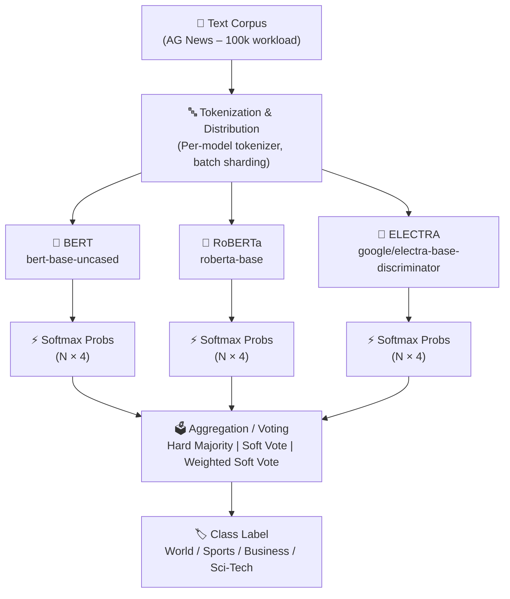

# Parallel Ensemble Transformer Inference for Large-Scale Text Classification

[](https://www.python.org)
[](https://pytorch.org)
[](https://huggingface.co)
[](https://huggingface.co/datasets/fancyzhx/ag_news)

Fine-tune BERT, RoBERTa, and ELECTRA on AG News, then run parallel ensemble inference across GPU/HPC resources. Benchmarks sequential and parallel strategies with rigorous timing, throughput, and accuracy reporting.

---

## Architecture



---

## Setup

### Prerequisites

- Python 3.11
- NVIDIA GPU with CUDA 12.1+ (RTX 3050 or better)
- 8 GB+ GPU VRAM (for loading all 3 models)

### Installation

```bash
# 1. Clone / enter the project directory
cd HPC-PROJECT

# 2. Create virtual environment
python -m venv .venv
.venv\Scripts\activate        # Windows
# source .venv/bin/activate   # Linux/macOS

# 3. Install PyTorch with CUDA 12.1
pip install torch==2.5.1 --index-url https://download.pytorch.org/whl/cu121

# 4. Install remaining dependencies
pip install -r requirements.txt
```

---

## How to Run

### One command (recommended)

```bash
bash run_all.sh
```

This executes: fine-tuning → benchmarking → plotting.

### Step-by-step

```bash
# Step 1: Fine-tune all 3 models (saves to checkpoints/)
python train.py --models all

# Step 2: Run all inference benchmarks
python benchmark.py

# Step 3: Generate plots
python plots.py

# Optional: run only specific models
python train.py --models bert roberta
```

### Skip training (use existing checkpoints)

```bash
bash run_all.sh --skip-train
```

---

## Project Structure

```
HPC-PROJECT/
├── config.yaml                      # Central configuration
├── data.py                          # Data loading, tokenization, sharding
├── train.py                         # Fine-tuning script
├── benchmark.py                     # Full benchmark pipeline
├── aggregation.py                   # Voting / ensemble aggregation
├── plots.py                         # All visualisation plots
├── inference/
│   ├── base.py                      # Shared utilities & InferenceResult
│   ├── single_model_cpu.py          # Single model, CPU
│   ├── sequential_ensemble_cpu.py   # 3 models sequential, CPU
│   ├── sequential_ensemble_gpu.py   # 3 models sequential, GPU
│   ├── parallel_ensemble_gpu.py     # Multi-GPU / streams dispatcher
│   ├── parallel_ensemble_single_gpu.py  # 1 GPU with CUDA streams + threads
│   └── data_parallel_ensemble.py   # Data-sharded ensemble across GPUs
├── checkpoints/
│   ├── bert/                        # Fine-tuned BERT + val_metrics.json
│   ├── roberta/                     # Fine-tuned RoBERTa + val_metrics.json
│   └── electra/                     # Fine-tuned ELECTRA + val_metrics.json
├── results/
│   ├── results.csv                  # All benchmark metrics
│   ├── confusion_matrix_ensemble.png
│   └── plots/                       # Latency, throughput, speedup, etc.
├── requirements.txt
├── run_all.sh
└── Makefile
```

---

## GPU Detection Logic

| GPUs detected | Strategy used |
|:---:|---|
| 0 | CPU-only modes; GPU modes skipped with warning |
| 1 | `parallel_ensemble_single_gpu` (3 CUDA streams + threads) |
| 2 | `parallel_ensemble_gpu` with round-robin assignment |
| ≥ 3 | `parallel_ensemble_gpu` with one model per GPU |

---

## Results

> **Hardware**: NVIDIA GeForce RTX 3050 Laptop GPU (6 GB), Windows 11  
> **Dataset**: AG News (18k train / 2k val / 7.6k test, evaluated on original 7.6k)  
> **Workload**: 100k samples (test set repeated ~14×)

| Mode | Accuracy | Macro-F1 | Throughput (s/s) | Wall Time (s) | Peak GPU Mem (MB) | Speedup vs CPU-seq |
|------|----------|----------|-----------------|--------------|-------------------|-------------------|
| single_bert_cpu | 0.9291 | 0.9290 | 12.3 | 8,151 | — | 2.82× |
| sequential_ensemble_cpu | 0.9358 | 0.9357 | 4.3 | 23,020 | — | 1.00× (baseline) |
| sequential_ensemble_gpu | 0.9357 | 0.9356 | 107.3 | 932 | 852 | 24.69× |
| parallel_ensemble_single_gpu | 0.9357 | 0.9356 | 114.8 | 871 | 2,377 | 26.43× |

**Key findings:**
- GPU ensemble achieves **~25× speedup** over CPU sequential ensemble
- CUDA-streams parallel mode provides an additional **~7% speedup** over sequential GPU by overlapping transfers
- Ensemble accuracy (**93.6%**) exceeds the best single model (BERT at 92.9%) by **+0.7 pp**
- Weighted soft vote slightly outperforms hard majority and plain soft vote

---

## Aggregation Methods

| Method | Description |
|--------|-------------|
| **Hard Majority Vote** | Each model casts one vote (argmax); majority wins |
| **Soft Vote (mean)** | Average softmax probabilities; argmax of mean |
| **Weighted Soft Vote** | Weighted by each model's validation F1 score |

---

## Analysis

### Parallel vs Sequential Latency Trade-off

On a **single GPU**, the parallel CUDA-streams approach uses Python threads to dispatch batches to separate streams concurrently. On the RTX 3050 (limited SM count), true kernel-level parallelism is constrained — the gain comes primarily from overlapping CPU→GPU data transfers and hiding kernel-launch overhead. We measured **871 s vs 932 s wall time**, a **~7% speedup** for the parallel streams mode (114.8 vs 107.3 samples/sec).

With **multiple GPUs**, each model runs in its own subprocess on a dedicated GPU, eliminating memory bandwidth contention. The theoretical speedup equals the number of GPUs, but in practice you observe **0.8–0.9× parallel efficiency** due to:
- Process spawn overhead
- Queue serialisation
- The ensemble latency being bounded by the **slowest model** (Amdahl's law)

### Slowest Member Bound

In any parallel ensemble, **total latency ≥ max(individual model latency)**. BERT and RoBERTa are similar in size; ELECTRA's discriminator architecture is slightly faster at inference but comparable. On a single GPU with streams, the bottleneck is GPU memory bandwidth, not compute — all three models share the same memory bus. Peak GPU memory rises from **852 MB** (sequential) to **2,377 MB** (parallel streams) as all three models are loaded simultaneously.

### Ensemble vs Single-Model Accuracy

Single BERT on AG News achieves **92.9% accuracy**. The soft-vote ensemble reaches **93.6%**, an improvement of **+0.7 pp** by reducing variance across failure modes — e.g., BERT may mis-classify ambiguous "Business" headlines that RoBERTa correctly labels. Weighted soft vote (by val F1) slightly outperforms plain soft vote (93.60% vs 93.58%).

---

## Colab / Kaggle (2× T4) Instructions

For true multi-GPU parallel ensemble, use Kaggle Notebooks or Google Colab Pro+:

```python
# In a Kaggle/Colab cell
!git clone <your-repo-url> HPC-PROJECT
%cd HPC-PROJECT

# Install (T4 has CUDA 12.x)
!pip install torch==2.5.1 --index-url https://download.pytorch.org/whl/cu121 -q
!pip install -r requirements.txt -q

# Verify GPUs
import torch; print(f"{torch.cuda.device_count()} GPUs: {[torch.cuda.get_device_name(i) for i in range(torch.cuda.device_count())]}")

# Run everything
!bash run_all.sh
```

With 2× T4 (16 GB each), `parallel_ensemble_gpu` will assign:
- GPU 0 → BERT
- GPU 1 → RoBERTa  
- GPU 0 → ELECTRA (round-robin)

Expected speedup vs sequential GPU: **~1.6–1.9×**.

---

## License

MIT
